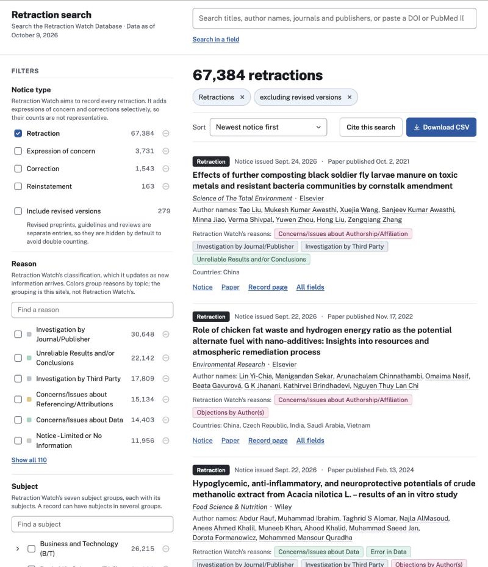

# Plan 002: Local search MVP

Status: draft, 2026-10-13. How to build [spec 002](spec.md). Decision records [002](../../decisions/002-search-engine.md) (Typesense on Railway) and [003](../../decisions/003-ui-stack.md) (Tailwind, headless components, URL-driven search) apply.

Typesense behavior cited here was checked on 2026-10-13 against the docs for version 30.0, the newest docs version; the server runs 30.2. The spikes below confirm the parts that matter on the real server.

## Design

Chosen from three interactive prototypes built on the 2026-10-09 snapshot: the layout with a filter sidebar. The prototypes aren't committed; this section records what they settled.



**Layout**

- A header in two columns: the site name and data date above the filter column, and the search box above the results, aligned with them.
- A 340 px filter sidebar. From top to bottom: notice type; including revised versions; reason; subject; country; notice year; paper year; article type; journal; publisher; notice paywalled; editorial-staff notices.
- Subject groups show Retraction Watch's names with their codes, such as "Basic Life Sciences (BLS)". The names come from its user guide's "Appendix A: Fields", checked 2026-10-13.
- The results column: the total by notice type, the query summary as removable chips, a toolbar (sort, Cite this search, Download CSV), the results and pagination.
- Below 820 px wide, the sidebar folds behind a Filters button and the header stacks.
- The header shows the site name, "Retraction search", with "Search the Retraction Watch Database · Data as of October 9, 2026" beneath it, the month spelled out. Result lines use AP abbreviations to save space.
- The footer reads, in three lines on a light gray background:
  1. "Data from the Retraction Watch Database, released under CC0 and distributed by Crossref at gitlab.com/crossref/retraction-watch-data. Snapshot of October 9, 2026 (commit `bc5648dd`), 73,100 records." The database name links to Retraction Watch's user guide, and the address to the GitLab repository.
  2. "Not affiliated with Retraction Watch or Crossref. Reasons are Retraction Watch’s classification. Author names are matched as names, not identified people."
  3. "About this data · Missing retraction? Tell Retraction Watch · Problem with this site? Open an issue on GitHub". "Tell Retraction Watch" links to the user guide.

  The GitHub issue opens with the page's link and the data date filled in, through GitHub's `title` and `body` URL parameters, worded as in the prototype: "Problem with the search" with "Search link: …" on the search page, "Problem with a record page" with "Record page: …" (the prototype gave only the ID, and AC25 asks for the link), and "Problem with this site" with "Page: …" elsewhere. The layout can't see the page's address on the server, so a small client component fills it in and follows filter changes; until it loads, the link opens an issue without the address. The no-results state repeats the GitHub link. The link only works for others once the repository is public.

**Filters**

- Each value is a row: a checkbox to include it, its count, and a small minus icon to exclude it (faint until hover on devices with a mouse).
- List filters with two or more included values show an "any / all" switch.
- Subject categories open with an arrow to show their subjects. Long filters have a search box and "Show all".
- Each filter carries its data caveat as a short note, in the prototype's words, ending with a "Read more" link to the About page (AC9): `/about#notice-types`, `#reasons`, `#countries`, `#paywalled` and `#dates`. The paper-year note adds "Dates below the year are approximate.", which the prototype left out but AC9 asks of both year filters.
- Each value's link is labeled for screen readers with the value, its count and its state, such as "Retraction, 67,384 records, selected" (AC32).
- On phones, "Filters" (with the number of choices that differ from the defaults) opens a Radix dialog holding the same sidebar, with "Show results" to close it. The prototype toggled the sidebar in place instead; the plan's dialog keeps keyboard focus while it's open.
- Year filters show a bar per year, which can be clicked to select that year, plus "from" and "to" inputs.

**Results**

- A notice-type label in words. Dates read "Notice issued Sept. 24, 2026 · Paper published Oct. 2, 2021", in AP style.
- The title (matched words highlighted), then the journal and publisher. Selecting either filters to it.
- Author names: the first ten, plus any further down that matched the search, then "Show all N names". A "Name match" tag appears when the search matched a name.
- Selecting an author name, in a result or on a record page, adds that exact name to the search. The summary reads "listing the author name '…'", and a yellow warning (no icon) says these are name matches only: different people can share a name, and the same person may appear under other spellings or with initials.
- Selecting the title or "Record page" opens the record page.
- Retraction Watch's reasons, colored by group. Countries.
- Retraction Watch's links, each with its date and how many records link to it.
- Links to the notice and the paper. "All fields" expands the rest in place.

**Search in a field** opens rows, each with a field (title, author name, institution, journal or publisher), "contains / doesn't contain" and some words. "Add a row" adds another. Helper text says that a row matches when all its words appear somewhere in that field, and explains how rows combine with each other and with the filters. Opening it doesn't move the header.

**Visual values**

- Typefaces: Public Sans for text, IBM Plex Mono for identifiers.
- Colors: grays from #16191D to #F7F8FA, one accent (#1F5AA6), and the excluded state in rust (#A84D17).
- Notice types: Retraction dark, Expression of concern amber, Correction gray-blue, Reinstatement green. Each always appears with its name.
- Reason colors: eight topic groups, plus "Other" for two reasons. Pastel backgrounds with dark text of the same hue; nothing is red. The grouping is this site's, not Retraction Watch's, and the Reason filter's note says so.

| Group | Matches reasons containing (in this order) |
|---|---|
| Investigations | starts with "Investigation by" |
| Notice and status | "Notice -", "Date of Article", "Removed", "Temporary Removal", "Update", "Retract and Replace", "EOC Lifted", "No Further Action", "Doing the Right Thing", "Nonpayment" |
| Data and results | starts with "Original Data" |
| Images | "Image" |
| Plagiarism, duplication and text | "Plagiarism", "Duplication of/in Article", "Duplication of Text", "Euphemisms for Duplication", "Taken from", "Taken via", "Salami", "Referencing", "Cites Retracted", "Error in Text", "Copyright" |
| Peer review and publishing | "Peer Review", "Paper Mill", "Rogue Editor", "Computer-Aided", "Third Party Involvement", "Hoax", "by Journal/Publisher", "Conference", starts with "Withdrawn" |
| Data and results | "Data", "Results", "Analyses", "Methods", "Materials", "Cell Lines", "Reproducible", "Contamination", "Sabotage" |
| Ethics, conduct and legal | "IRB", "Consent", "Welfare", "Ethical", "Conflict of Interest", "Misconduct", "Bias", "Legal", "Civil", "Criminal", "Publishing Ban", "Euphemisms" |
| Authorship and approval | "Author", "Affiliation", "Approval", "Objections", "Complaints", "Miscommunication" |

On the 2026-10-09 snapshot, this puts each of the 112 reasons in a group, and two in "Other". Because filter values come from the data, a new reason that matches no rule lands in "Other", and the check report lists it.

## How it fits together

```
browser ──► Next.js server code (web/) ──► Typesense 30.2 (Docker)
                    │
                    └──► Redis (Docker): per-visitor rate-limit counters

pipeline: npm run clean ──► search-documents.jsonl ──► npm run load ──► Typesense (admin key)
```

New and changed files:

- `docker-compose.yml`: Typesense (`typesense/typesense:30.2`) with its data in `data/typesense/`, and Redis (`redis:8.10.2-alpine`, the newest release on Docker Hub, checked 2026-10-13). Both listen only on 127.0.0.1. `npm run search:down` stops them.
- `pipeline/src/load.js`: loads the newest cleaned snapshot into Typesense (below).
- `pipeline/sql/10_records.sql`: merges journal and publisher spellings, and fixes backticks in author names (below).
- `pipeline/sql/20_search_documents.sql`: adds `url_record_counts` (below).
- `web/`: the Next.js 16.4 app, with React 19.3, Tailwind CSS 4.3, TypeScript 7.0 and Vitest 5 (versions checked on npm 2026-10-13). Next.js type-checks with TypeScript 7's `tsc` command, because TypeScript 7 has no JavaScript compiler API (Next.js TypeScript docs, checked 2026-10-13). The theme in `web/app/globals.css` holds the prototype's exact colors, and a test checks that every label's text meets WCAG AA contrast.
- `.env.local` (not committed): the Typesense admin key (used only by `load`), the site's read-only key, the Redis URL and the salt for hashing visitors. One file serves Docker, the pipeline and the site: the site's npm scripts run Next.js through `web/scripts/next.mjs`, which loads it first. Loading it before Next.js starts matters, because Next.js resets `process.env` to its own starting values when it reloads env files. A host that sets variables itself has no `.env.local`.

## Data in Typesense

**Loading.** `npm run load`:

1. Creates a collection named after the snapshot and the load time, such as `retractions_2026-10-09_bc5648dd_20261013T222801Z`, with the schema below. Loading the same snapshot again gives a fresh collection.
2. Imports the search documents in batches. Typesense's import returns HTTP 200 even when documents fail, so the script reads every result line and stops on the first failure.
3. Checks that the document count equals the snapshot's row count. It also stops if two values of any string filter field (journal, publisher, notice type, paywalled, reasons, subjects, subject categories, countries, article types) differ only in capitals or accents, because Typesense's exact filters would merge them (spike S8). The cleaning prevents this for journals and publishers.
4. Points the alias `retractions` at the new collection, then deletes collections older than the previous one.
5. Writes the snapshot's data date and commit to a one-document `meta` collection, which pages read for the data date. The same document maps each journal and publisher value that Typesense cut at 255 bytes to its full name (spike S2). The load stops if two names share a cut value, since their counts would merge. It also checks every journal and publisher facet value Typesense returns against the documents before switching the alias. On 2026-10-13 that check stopped one load out of nine: right after the import, Typesense returned a publisher name with one Cyrillic letter missing, a spelling that isn't in the data. It didn't happen again in eight more loads, or in 1,435 faceted searches over a minute on a loaded collection, so the cause was unknown. Spec 003's spike S2 found it on 2026-10-15: a Typesense bug drops a letter from imported text in about one import in three, and this check sees only about half of the damage. The load now escapes the text it imports and compares every stored document with the cleaned file (decision record [004](../../decisions/004-typesense-import-escaping.md)).
6. Creates or reuses the site's key, limited to `documents:search` and `documents:export` on `retractions` and `meta` (spikes S4 and S5). Both actions only read. A new key is saved to `.env.local` as `TYPESENSE_SEARCH_KEY`, and older keys from the load are deleted.

Spec 003 reuses this script for the daily run.

**Schema.** Fields outside the schema are stored and returned but not indexed (decision record 002). Title, institutions, journal and publisher split words at hyphens and slashes as well as spaces (`token_separators`). Typesense otherwise joins "cancer-associated" into one word, so "cancer" missed it, and 24,804 of the 73,100 titles hold a hyphenated word (checked 2026-10-13). Author names and the filter lists keep the default, because with the split, Typesense's exact filter on a list matched different names that share some words. Field terms split the same way, except author names.

| Field | Type | Indexed for |
|---|---|---|
| `title` | string | search |
| `authors`, `institutions` | string[] | search |
| `journal`, `publisher` | string | search and filters |
| `notice_type`, `paywalled` | string | filters |
| `reasons`, `subjects`, `subject_categories`, `countries`, `article_types` | string[] | filters |
| `is_revision`, `has_editorial_staff_author` | bool | filters |
| `notice_year`, `paper_year` | int32 | filters and per-year counts |
| `notice_date`, `paper_date` | int64 (Unix seconds, negative before 1970) | sorting |
| `notice_doi`, `paper_doi` | string | exact lookup |
| `notice_pubmed_id`, `paper_pubmed_id` | int64 | exact lookup |
| `record_id` | int32 | record pages |
| `urls`, `url_record_counts`, `notes`, `original` | not indexed | shown on results and record pages |

**Pipeline additions.**

- `url_record_counts` gives, for each of a record's URLs, how many records list the same URL, ignoring http versus https and a trailing slash (AC18a). Computing this in SQL keeps it a single pass over the snapshot instead of an extra query per page.
- Typesense's exact filters ignore capitals and accents and can't hold a backtick (spike S8). The owner treats both as bad data, so the cleaning fixes them instead of the site working around them:
  - Journal and publisher spellings that differ only in capitals or accents become the most common spelling, with ties going to the first spelling in sort order. On the 2026-10-09 snapshot that merges 13 journal names into 6 and "springer" into "Springer". Filter counts and results then agree.
  - In author names, a backtick between two letters becomes an apostrophe (`'`, which author names use about twice as often as `’`), and any other backtick is removed. This affects six names.
  - `original` keeps the published journal, publisher or author text wherever these change it (AC22).
  - Author matches ignore capitals and accents, which AC14 now allows.

  Hashed keys for exact names were tried first and dropped: measured on 2026-10-13, each in a fresh Typesense 30.2 container, the 2026-10-09 collection takes 220 MB without them and 261 MB with them.

## The query

One `Query` type holds everything the URL can say: search text, field terms with their any or all choice, each filter's included and excluded values with its any or all choice, the year ranges, the revision and editorial-staff options, the sort order and the page.

Pure functions in `web/lib/query/`, all unit-tested:

- `parseQuery(searchParams)` and `serializeQuery(query)`. Serializing gives one canonical form, and parsing it back returns the same query. The default view serializes to no parameters (AC16).
- `describeQuery(query)` gives the summary's parts, each with what removing it does, and the plain-language sentence (AC15). The citation (AC24) builds on it.
- `toTypesense(query)` gives the body of one `multi_search` request.

URL parameters follow the prototype:

- `q`
- `in_title`, `not_in_author` and so on, with `in_<field>_match=all`
- `author_name`, repeated for each selected name
- `type` (absent means retractions only; `type=all` means every type). Once the URL names a type, with `type` or `not_type`, the default no longer applies.
- `reason`, `not_reason`, `reason_match=all`, and the same for `subject`, `country`, `article_type`, `journal`, `publisher` and `paywalled`. Only the list fields (reason, subject, country, article type) can match all. A `subject` value is either a category code (`BLS`) or a subject with its code (`BLS: Neuroscience`). A value that's both included and excluded counts as excluded.
- `notice_from`, `notice_to`, `paper_from`, `paper_to`: four-digit years. A reversed range is turned around.
- `revisions=include`, `editorial_staff=exclude`
- `sort`: `relevance`, `newest`, `oldest`, `paper_newest` or `paper_oldest`. A sort that gives the default order is left out, and relevance without search text means newest first.
- `page`, starting at 1

Values are the values in the data, so URLs stay readable. Unknown parameters are ignored. To keep a hand-made URL from building a huge search, a query holds at most 10 field terms, 10 author names, 50 values per filter and 1,000 characters per text.

**One request for results and every count.** Typesense's `multi_search` sends up to 50 searches in one HTTP request. The body holds:

- the main search: every clause, the page of results, the counts for small filters that have no selection or are set to "all", and the count by notice type for the total (AC17)
- the top 40 journals and publishers, when those filters have no selection. Typesense's `max_facet_values` applies to a whole search (a per-field limit is rejected, checked 2026-10-13), so long filters get a search of their own.
- one more search per "any" filter that has a selection: every clause except that filter's own, no results, counts for that field only (AC4)
- the same for the two year filters and the two options, so their counts ignore their own setting
- for selected journals or publishers, one search limited to the selected values, so each has its count even outside the top 40 (AC6)
- with search text, a count of exact matches (`num_typos` 0, no results), which shows whether the results came only from close spellings

That's at most 17 searches. Every clause comes from `toTypesense`, which strips backticks from values, since a backtick would end the literal and no value in the data holds one.

**Mapping to Typesense filters.** Values are written as backtick literals, so commas and parentheses inside values are safe.

| Query part | `filter_by` |
|---|---|
| Any of several values | ``reasons:=[`A`, `B`]`` |
| Subject categories and subjects | ``(subject_categories:=[`BLS`] || subjects:=[`HSC: Medicine - Oncology`])`` |
| All of several values | ``reasons:=`A` && reasons:=`B` `` |
| Excluded values | ``reasons:!=[`C`]`` |
| Year range | `notice_year:>=2015 && notice_year:<=2020` |
| Options | `is_revision:=false`, `has_editorial_staff_author:=false` |
| Field term (all its words, anywhere in the field) | `institutions:University of Toronto` |
| Excluded field term | ``(institutions:! university || institutions:! of || institutions:! toronto)``, which keeps records missing any of the words |
| Selected author names (each must be listed, ignoring capitals, accents and punctuation) | ``authors:=`Maria Example` && authors:=`Jun Sample` `` (spike S8) |
| Identifier lookup | ``notice_doi:=`x` || paper_doi:=`x` ``, ignoring every other clause |

**Search text** uses `q` over `title,authors,institutions,journal,publisher`, settled by spike S6:

- `num_typos` 2,1,1,2,1: two typos in titles and journals, one in author names, institutions and publishers.
- `drop_tokens_threshold` 0, so a search never quietly drops words.
- Typesense's default fallback: other spellings are tried only when a search has no exact match.
- When the exact-match count is 0 but close spellings match, the page says so, for example "No exact matches for 'iraq' with these filters. Showing close spellings, highlighted." The server then reruns the request with typos on for every search (a very high `typo_tokens_threshold`), so that the results and counts agree. Only this case costs a second request.

**Sorting:** relevance is `_text_match:desc,notice_date:desc,record_id:desc`; the date orders sort on `notice_date` or `paper_date`, then `record_id`. The tie-breaker keeps pages from overlapping (spike S3).

**Filter counts:** small filters (notice type, reason, subject, country, article type, paywalled) return every value in one go. Publisher and journal return their top values, and their search box asks `/api/facet-values`, which uses Typesense's `facet_query`. That matches each typed word as the start of a word in the name and ranks by count, so a short or common name ("Health", "Chem") can rank past the top 40; the same request also looks for a value named exactly as typed, ignoring capitals and accents, and lists it first. Checked 2026-10-13: every one of the 8,771 journals and 1,717 publishers is found by typing its two longest words (10,018), its four longest (418) or its name (52). Journal and publisher values that Typesense cut at 255 bytes are swapped for their full names from `meta` before they're shown or linked.

**Highlighting** uses Typesense's highlight output for title and authors, with marker strings that the page splits into text and `<mark>` elements. No returned HTML is inserted directly.

## Pages and server code

| Path | What it does |
|---|---|
| `app/page.tsx` | Server component. Parses the URL, checks the rate limit, runs the `multi_search`, renders everything. |
| `app/record/[id]/page.tsx` | Fetches one record with a search filtered by `record_id`, because the site's key can't fetch documents directly. Shows every field, with the original values next to the cleaned ones. The URL is always just `/record/<id>`, so links to a record never carry a search. The header has the site name and data date but no search box. |
| `app/about/page.tsx` | The data source, license, caveats, how counts work, and how to report a missing retraction (AC26). The prototype has no About page, so its text is new: one section per caveat in the brief, with the ids the filters' "Read more" links use. The license source is Crossref's metadata page, whose license table lists the Retraction Watch database under CC0 (checked 2026-10-14). Record pages and About share a header without a search box. |
| `app/not-found.tsx`, `app/record/[id]/not-found.tsx` | 404 pages with the shared header and the footer: "Page not found" for an unknown address, and "No record with this ID" for a record ID that isn't in the snapshot. An unknown address is rendered on the server. A missing record is not: in Next.js 16.4, `notFound()` from a page reaches the browser as an empty error shell with HTTP 404 and `noindex`, and the browser then draws the not-found page, because React error boundaries don't run during server rendering (checked in development and in a production build, 2026-10-14). Without JavaScript the page is blank. Rendering it on the server would need a proxy that looks the record up before the page does, which doubles the Typesense searches for record pages; not done. |
| `app/api/facet-values/route.ts` | Value search for long filters. |
| `app/api/export/route.ts` | The CSV download (below). |

**Client components:**
- the search box and field-search rows (they update the URL after a 300 ms pause)
- year inputs
- the value search in long filters
- the phone filter drawer (Radix Dialog)
- tooltips (Radix Tooltip)
- the sort menu and the field-search menus (Radix Select): the owner prefers them to the browser's built-in list, and Radix keeps the keyboard and screen-reader behavior
- the copy-citation button
- "Download CSV": a link to `/api/export` that, with JavaScript, fetches the file and saves it from the page. A failure, or the download limit (task 19), then shows as a notice on the page instead of replacing it, as in the prototype's states. The file is held in the browser's memory until it's saved: 64 MB for the whole default view.
- "Copy link to this record" on record pages
- "Back to results" on record pages, shown only when the previous page was a search on this site (a same-site referrer on the search page). It calls the browser's back, so the results and scroll position come back as they were.

**Filter links** are `<Link prefetch={false} scroll={false}>`. A clicked value shows as selected straight away, and the old results dim until the new ones arrive. Next.js 16's API for showing link status gets checked at setup.

**Screen readers and the keyboard (AC32).** When the results change, screen readers hear one short sentence from a status message, such as "271 retractions, page 1 of 14.", or that the results are close spellings. It sits outside the part of the page marked busy while a search loads, and the results' heading and summary aren't a live region, so nothing else is announced over it. (In the VoiceOver check on 2026-10-14, the summary's new "matching" chip cut off the total.) The filter column comes before the results in the page, so a "Skip to results" link follows the search box, shown when it has focus; it moves focus to the results column.

**Server-only code** lives in `web/lib/server/`, which imports `server-only` so it can't end up in browser code. The search key is read there from the environment and never passed to a component (AC27).

## Rate limits and failures

**Rate limits (AC28).**
- **Mechanism:** a fixed-window counter in Redis per visitor. A visitor is a salted hash of the first address in `x-forwarded-for`; no cookies.
- **Limits:** 60 searches a minute and 6 downloads an hour per visitor (agreed 2026-10-13). Windows start on the minute or the hour. `RATE_LIMIT_SEARCHES` and `RATE_LIMIT_DOWNLOADS` lower them for tests.
- **What counts:** each search page and each journal or publisher value search counts as a search; each `/api/export` request counts as a download. Record pages don't count. Link prefetches don't count either: in a production build, scrolling through results prefetched `/` and the record pages without adding to the count (checked 2026-10-14). Since spec 004's spike S2, the results' record links don't prefetch, because the firewall rule counts every request (plan 004, "Limits").
- **When a page is over the limit,** it renders the notice with the time to try again, and keeps the query.
- **When a route handler is over the limit,** it returns HTTP 429 with `Retry-After`, and the limit in the JSON body so the page can state it. The download button then shows the prototype's "Download limit reached" notice, with the time in the visitor's own time zone.
- **Visitor address:** the first address in `x-forwarded-for` can only be trusted if the host's proxy replaces that header rather than appending to it. Vercel replaces it (decision record 005, checked 2026-10-15).
- **Production store:** not chosen yet. The first live release turns these limits off and relies on a Vercel firewall rule (spec 004), and a later iteration picks the store. Redis on Railway was the first choice, but Railway's Redis has no TLS for connections from outside Railway (decision record 005).

**Failures (AC29).** If Typesense or Redis can't be reached, the page shows "Search is unavailable right now", with the attribution and the query kept, instead of an error page. If Redis alone is down, searches go ahead without rate limiting and the failure is logged, so a counter outage doesn't take search down with it. A page waits at most 500 ms for its count. While Redis is disconnected the check fails at once; while it hangs, each request waits the 500 ms. A missing `REDIS_URL` or `VISITOR_HASH_SALT` is logged and treated the same way. The log says when limits go off, at most once a minute, and when Redis is back.

## CSV download

`/api/export` takes the same URL parameters as the search page.

- **Without search text:** it streams Typesense's export endpoint, which takes `filter_by` and `include_fields` and returns JSON lines in chunks. Field terms, author names and identifier lookups are filters, so they go this way too (spike S4). The site's key has `documents:export` for this. The endpoint can't sort, so these files come in record ID order.
- **With search text:** the export endpoint has no search-text parameter, so the handler pages through search results 250 at a time (the per-page maximum) and streams each page as it arrives, in the page's order. In spike S4 the largest text search (65,691 records) took 14.6 s this way. When the page shows close spellings, the download pages with typos on for every search too, so it holds the same records.
- **Checks:** before sending anything, the handler reads the data date and the total, so an unreachable Typesense still gets HTTP 503. Once the file has started, it can't change its status. So if it ends with a different number of records than the total, or a record twice, the handler breaks off the stream and the browser reports a failed download rather than saving a short file.
- **Format:**
  - UTF-8 with a byte-order mark, so spreadsheet apps keep non-English characters.
  - A header row, and one column per field shown on record pages.
  - List fields joined with "; ". No entry can contain a semicolon, because the cleaning split on semicolons, so splitting on ";" and trimming gives the entries back exactly (AC23).
  - The file name includes the data date, such as `retraction-search-2026-10-09.csv`.

## Tests

| What | How | Covers |
|---|---|---|
| Query parsing, serializing, summary, citation, Typesense mapping, reason groups, date format | Vitest unit tests in `web/`, no network | AC2, AC4, AC5, AC11, AC12, AC15, AC16, AC17, AC19, AC24 |
| Counts against DuckDB | `npm run check:search`: a fixed set of queries run against the local stack and against DuckDB on the same snapshot, comparing totals and every filter count | AC4, AC6, AC8, AC30 |
| Search behavior on real data | The same script: deep paging to the last page, years before 1970, the twelve name pairs from spike S6 in both directions, the close-spellings fallback, identifier lookups, export round trip | AC8, AC12, AC13, AC20, AC23 |
| Pages | Playwright on the local stack, with axe on the start, results, no-results and record pages, plus keyboard-only runs | AC1–3, AC7, AC9, AC10, AC14, AC18, AC18a, AC18b, AC21, AC22, AC25, AC26, AC31, AC32 |
| Failures | Playwright with Typesense stopped and with the rate limit set low | AC28, AC29 |
| No key in the browser | A test that builds the app, then searches the built browser files, page HTML and responses for the key | AC27 |
| Speed | A script timing the server response for the fixed query set (p95), and Lighthouse's mobile test on a shared URL | AC33 |
| Commands | Run from a fresh clone | AC34 |
| Screen reader | A written manual VoiceOver check covering one full search: [voiceover-check.md](voiceover-check.md) | AC32 |

`npm test` stays network-free. The checks that need Docker and the full snapshot run through their own commands.

**How `npm run check:search` works (task 21).** It runs the site's own server code (`runSearch`, `startExport`) against the local Typesense, and reads the same snapshot's search documents into DuckDB, found through the `meta` document. The filters are written again in SQL from the spec, not from the Typesense mapping. For each of 17 filter-only queries it compares the total, the totals by notice type and every filter count shown. Long filters are checked to show their top values. The name pairs from spike S6 can't be compared by count: Typesense expands a prefix to only a few candidate words, so it skips rare ones such as "iran0". So the check models Typesense's words in DuckDB (split at spaces, and at hyphens and slashes outside author names, with other punctuation dropped, so "He'nan" is "henan") and asserts that every record with the exact word is found and every result has a word starting with it. On the 2026-10-09 snapshot all 49 cases pass in about 15 s (checked 2026-10-14).

**How `npm run test:e2e` works (task 22).** It builds the site, and Playwright starts the build three times: on port 3100 with 40 searches a minute and 2 downloads an hour so the limit tests run quickly, on 3101 with Typesense unreachable, and on 3102 with Redis unreachable. The tests use the installed Google Chrome, so no browser is downloaded. Each test sends its own made-up `X-Forwarded-For` address (from 198.18.0.0/15, reserved for testing), so rate limits don't carry over between tests or runs. axe checks WCAG 2.2 AA on the start, results, no-results, record and About pages. The year bars are narrower than the 24px target size; WCAG 2.5.8 exempts a target when another control on the page does the same thing, as each year filter's "from" and "to" inputs do, so the bars skip only axe's target-size rule. The record page's author names were too small targets and now are 24px tall. 25 tests pass in about 20 s (checked 2026-10-14).

**How `npm run check:speed` works (task 24).** It builds the site and starts it on port 3200, with the limits raised so one address can time many searches. It requests 14 searches 10 times each, from the default view to "of" across the five fields and the last page, timing the whole server response. Then it runs Lighthouse 13.5's mobile test (simulated phone and slow network) five times on the brief's example search, and reports the median Largest Contentful Paint, since single runs varied from 2.1 to 2.8 s. On a laptop with the local stack (2026-10-14): p95 107 ms against the 300 ms budget, and a median LCP of 2.26 s against 2.5 s. The LCP element is the first result's title. Preloading all six font files put the median at 2.56 s, so IBM Plex Mono, used only for record IDs and the commit, is no longer preloaded; it shows in the fallback monospace font until it arrives, with no layout shift. The owner confirmed the AC33 budgets on 2026-10-14.

**Fresh clone (task 25), 2026-10-14.** In a new clone with a new `.env.local`, every command succeeded: `npm install`, `npm run download` (the 2026-10-13 snapshot), `npm run clean` (73,184 records in 3.6 s), `npm run search:up`, `npm run load` (6.6 s), `npm run web` (67,467 retractions on the start page) and `npm run check:search` (49 of 49 on the new snapshot).

**Known limit: author names in other scripts (AC14).** Typesense's exact filters ignore capitals only for Latin letters. On the 2026-10-09 snapshot, 3 of the 967 groups of author names that differ only in capitals or accents (6 names) differ in Cyrillic capitals, and a name link finds only its own spelling. The check covers the groups that differ in Latin capitals or accents.

## Spikes first

Each is a short experiment against the local stack before the matching tasks start. If one fails, the spec gets a proposed change before code continues.

- **S1, field terms (AC11). Run 2026-10-13 on Typesense 30.2; a filter can't hold a phrase to one entry.** Decided: match word by word for now (see "Field terms" below).
- **S2, exact counts (AC4, AC30). Run 2026-10-13: totals and counts are exact, but long facet values are cut short.** Eleven filter sets gave the same total, and the same count for every value of all 13 facet fields, as DuckDB on the same documents. The sets were: everything, the defaults, any of two reasons with a country excluded and a notice-year range, all of two reasons, two countries excluded, two notice types, a subject category minus one subject, paper years before 1970, editorial-staff notices, a journal name with commas and parentheses, and paywalled "Unknown". Leaving `facet_strategy` at `automatic` or setting it to `exhaustive` made no difference. One request holding 12 searches (the main search and one counts search per filter) took a median of 73 ms over 20 runs, 117 ms at most. Two things to carry into the code:
  - Typesense returns at most the first 255 bytes of a facet value, ending on a whole character. On the 2026-10-09 snapshot that cuts 69 journal names and 66 publisher names, all long bilingual titles. Filtering on the full name still matches, and no two names share their first 255 bytes, so the counts are right; only the displayed value is cut. See proposed change P1.
  - DuckDB has to count distinct records, because record 66627 lists one subject twice.
- **S3, deep paging (AC20). Run 2026-10-13: passes.** `limit_hits` defaults to no limit. The last page of the 67,384 default results (page 3,370 at 20 a page) loads in under 100 ms and ends with the oldest notice, as in DuckDB; the page after it is empty. A text search pages to its end the same way. Date sorts need `record_id` as a tie-breaker so that pages don't overlap.
- **S4, export. Run 2026-10-13: works for every filter form, but not with a search-only key.** The export endpoint answers HTTP 401 to a key that only has `documents:search`. With `documents:export` added, it returns the same records as the search for every form in the mapping table: any of, all of, excluded values, year ranges, years before 1970, the two options, word-level field terms and their exclusion, an exact author name, an identifier lookup and a value with commas and parentheses. The whole default view (67,384 documents, every field, 103 MB of JSON) exports in 2.3 s. The largest text search tried, "of" across the five fields under the defaults (65,691 records), pages through in 14.6 s at 250 a page: 263 pages, a median of 50 ms each. See proposed change P5.
- **S5, keys (AC27). Run 2026-10-13: passes.** Typesense checks a key's collections against the name a search asks for. A key listing only `retractions` searches through the alias but not the collection behind it, and a key listing only `retractions_.*` does the opposite. The patterns match whole names: `etractions_.*` matches nothing. So the site's key needs only `retractions` and `meta`. The search-only key gets HTTP 401 for listing collections, fetching a document, exporting, writing, deleting a collection and listing keys.
- **S6, typos (AC10, AC13). Run 2026-10-13: near-identical names stay apart while a search has exact matches, but not after.** By default, Typesense tries other spellings only when a search finds no exact match (`typo_tokens_threshold` 1). Twelve pairs of common words in institution names were tested in both directions: Toronto and Torino, Hunan and Henan, Hubei and Hebei, Iran and Iraq, Shaanxi and Shanxi, Suzhou and Xuzhou, Nanjing and Nanning, Boston and Houston, Neurology and Urology, Cardiology and Radiology, Austria and Australia, and Finance and France.
  - With the default view's filters, no search for one word of a pair returned records that only had the other.
  - When the filters leave no exact match, Typesense falls back to close spellings. For example, "iraq" with the country set to one where no record has that word returns 18 records that list Iran. In that state the filter counts disagree with the results, because the counts come from searches that still have exact matches: that country's count says 0.
  - Turning typos on for every search (a very high `typo_tokens_threshold`) keeps counts consistent but mixes pairs everywhere: "hunan" grows from 1,149 results to 4,814, mostly matches for "human".
  - Allowing one typo for author names, institutions and publishers (`num_typos` 2,1,1,2,1 for title, authors, institutions, journal and publisher) keeps two-letter pairs apart in the fallback (Toronto and Torino, Boston and Houston, Austria and Australia), but not one-letter pairs such as Hubei and Hebei. It also loses two-letter misspellings in those fields. In a sample of words changed by one letter (two for words of eight letters or more), the record was still found for 0 of 21 author names and 6 of 118 institution words with two changes, against 21 and 115 with the defaults. With one change it was found in every field under both settings: 36 of 36 author names, 80 of 80 institution words, 12 of 12 journal words and 30 of 32 title words.
  - By default, a multi-word search that matches nothing quietly drops words: "toronto zebrafish" returns all 196 Toronto records. `drop_tokens_threshold` 0 stops this.
  - A hit's `text_match_info.typo_prefix_score` is 0 for an exact match but also above 0 for a plain prefix match, so it can't detect the fallback alone. A count with `num_typos` 0 can.

  See proposed changes P3 and P4, and the proposed change to AC13.
- **S7, dates before 1970 (AC8). Run 2026-10-13: passes.** Sorting by paper date or notice date, either way, gives the same first 250 records as DuckDB, starting with record 18930 (paper 1753, notice 1756). The 49 papers from before 1970 fall in 22 years, with the same count per year as DuckDB, and the 7 notices dated before 1970 filter correctly.
- **S8, exact author names (AC14). Run 2026-10-13: exact filters ignore capitalization and accents, and can't hold a backtick.** ``authors:=`…` `` matches whole list entries: a name that starts a longer listed name doesn't match the longer one. But it ignores capitalization and accents. Of the 21 names tested, 5 matched more records than DuckDB: 8 extra records listed the name in different capitals and 1 with a different accent. On the snapshot, 1,945 author names fall into 967 groups that differ only in that way. Every exact filter behaves the same: 13 journal names in 6 groups and one pair of publishers differ only in capitals or accents, and filtering on one returns them all (one journal's facet count is 4, but filtering on it returns 62). Six author names contain a backtick, which ends a backtick literal early. Neither a backslash nor leaving out the backticks helped, and those filters match unrelated records. See proposed change P2.
  - Rechecked 2026-10-13 with the 100 most common hyphenated author names: the exact filter also ignores punctuation, so it matches the same name with a dropped hyphen, a non-breaking hyphen or a trailing comma. Of 1,271 matches, 1,149 listed the name exactly and 122 listed it with only capitals, accents or punctuation changed; none listed a different name.

## Changes agreed from spikes S2–S8

Agreed with the owner on 2026-10-13. The sections above describe them as built.

- **P1, full names for cut facet values (S2).** `npm run load` compares Typesense's journal and publisher facet values with the documents. It stores the full name for each value Typesense cut short in the `meta` document (135 on the 2026-10-09 snapshot), and the site shows and links the full name. The load fails if two names share a cut value, since their counts would merge.
- **P2, hashed keys for exact matches (S8). Replaced the same day by cleaning the names; see "Pipeline additions".** The pipeline adds `author_keys` (one per entry in `authors`), `journal_key` and `publisher_key`: the first 16 hexadecimal characters of the SHA-256 hash of the exact name. Selected author names, journals and publishers filter on the keys, which keeps capitals, accents and backticks exact. URLs still hold the names, and the server computes the keys. Facet counts still come from the name fields, which keep capitals. The estimate here was about 5 MB; measured, the keys add 41 MB per collection (see "Pipeline additions"). A check on each snapshot flags any other filter field (reasons, subjects, countries, article types) whose values start to differ only in capitals or accents.
- **P3, never drop words (S6).** Every search sets `drop_tokens_threshold` to 0.
- **P4, typo settings and close spellings (S6).** `num_typos` 2,1,1,2,1 (title, authors, institutions, journal, publisher), with Typesense's default fallback. Each request also counts the exact matches (`num_typos` 0, no results). When that count is 0 but close spellings match, the page says so, for example "No exact matches for 'iraq' with these filters. Showing close spellings, highlighted." It then reruns the request with typos on for every search, so that the results and counts agree. The alternative is to show the fallback without rerunning, and accept counts that disagree with the results in that state.
- **P5, the site's key can also export (S4, S5).** The load creates one key with `documents:search` and `documents:export`, limited to `retractions` and `meta`. Both actions only read. Record pages still search by `record_id`, since the key can't fetch documents.
- **AC13, proposed wording:** "Typo tolerance doesn't mix up near-identical names while the search has exact matches. A fixed list of name pairs, starting with Toronto and Torino, is tested in both directions. When the filters leave no exact match and the page falls back to close spellings, it says so. The words that matched are highlighted in each result, so a match on a different spelling is visible."

## Field terms: what spike S1 found

Tested on 2026-10-13 against Typesense 30.2 in Docker, with five synthetic records:

- **The word-level filter** `institutions:University of Toronto`, with or without backticks, matches when every word appears anywhere in the field. Word order doesn't matter, and the words can come from different entries.
- **A quoted phrase in the search text,** searching only `institutions`, matches the phrase within one entry, which is what AC11 asks for. But a search has a single search text, so it can't serve the search box and a field term at once.
- **Word exclusion** (`title:! cancer`) works. Negating a group with `!( … )` doesn't parse, so exclusions are written as `||` chains of `:!=`.
- **Same-entry filters** (`field.{…}`) work on plain values, but hung with no response in 20 seconds when each entry held a list. Avoid that shape.

Measured on the 2026-10-09 snapshot (retractions without revised versions):

| Phrase in institutions | True phrase in one entry | All words anywhere in the field | Word pairs within one entry |
|---|---|---|---|
| University of Toronto | 131 | 167 | 131 |
| University of California | 448 | 628 | 448 |
| Chinese Academy of Sciences | 534 | 906 | 534 |
| Department of Medicine | 832 | 8,744 | 4,082 |

Word pairs fail on generic phrases because one affiliation string often names several units ("Department of Surgery, Faculty of Medicine"). Three ways forward:

1. **Word pairs and triples, stored by the pipeline and matched with exact filters.** A phrase of up to three words matches its own pair or triple, which is contiguous by construction. Longer phrases chain overlapping triples, which could rarely over-match. One request, and counts stay exact. The cost is index memory: about 5.1 million entries and 88 MB of text for institutions and titles. By decision record 002's rule of thumb that's roughly 175–265 MB more memory, or $2–3 a month on Railway (an estimate to measure).
2. **Two steps.** A phrase search on the field collects the matching record IDs, and the main search filters to them. This uses Typesense's own phrase matching and needs no extra memory, but costs an extra round trip. IDs arrive 250 per page, up to 50 pages per request, so very broad phrases need a fallback.
3. **Relax AC11:** a multi-word term matches when all its words appear in the field. The simplest option, but it over-counts generic phrases ten times over.

**Decided 2026-10-13: option 3 for now.** The field-search helper text says a row matches when all its words appear somewhere in the field. Options 1 and 2 stay here in case over-counting becomes a problem. Option 1 would start by loading the full snapshot with pairs and triples to measure the memory.

## Spec changes agreed

- **AC12** (2026-10-13): an identifier lookup ignores the filters and says so. Otherwise the DOI of an expression of concern finds nothing under the retractions-only default.
- **AC13** (2026-10-13, after spike S6): near-identical names stay apart while the search has exact matches. When the filters leave no exact match and the page falls back to close spellings, it says so.
- **AC14** (2026-10-13): author matches ignore capitals and accents, the owner's call, and also punctuation, which Typesense drops when indexing. Punctuation is dropped rather than read as a space: "Ana Ma-Smith" matches "Ana Masmith" but not "Ana Ma Smith".

## Commands (AC34)

| Command | What it does |
|---|---|
| `npm run search:up` | Starts Typesense and Redis in Docker |
| `npm run load` | Loads the newest cleaned snapshot into Typesense |
| `npm run web` | Starts the site at http://localhost:3000 |
| `npm run check:search` | Runs the checks that need the local stack and full data |

Docker Desktop or a similar Docker setup is needed (decision record 002).

## Still open

- From the spec: the speed budgets, and how to label Retraction Watch links that aren't blog posts.
